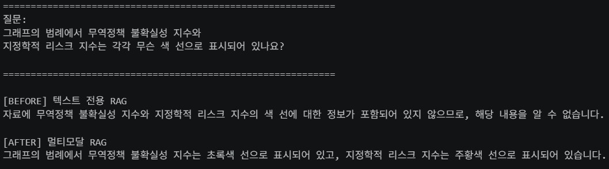
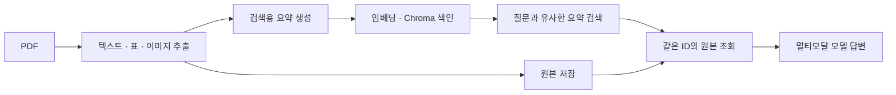

# Multimodal RAG

**경제전망 PDF의 텍스트·표·그래프를 함께 검색하는 질의응답 프로젝트**

PDF에서 텍스트, 표, 이미지를 추출하고 검색용 요약을 벡터화합니다. 질문과 관련된 요약을 찾은 뒤 연결된 원본을 멀티모달 모델에 전달해 한국어 답변을 생성합니다.

`Python` · `LangChain` · `Chroma` · `Unstructured` · `OpenAI` · `Jupyter`

## Before / After

**질문:** 그래프에서 무역정책 불확실성 지수와 지정학적 리스크 지수는 각각 무슨 색 선인가요?

| 방식 | 실제 답변 |
| --- | --- |
| 텍스트 전용 RAG | 색상 정보가 없어 알 수 없음 |
| 멀티모달 RAG | 무역정책 지수는 **초록색**, 지정학적 리스크 지수는 **주황색** |



한국은행 「경제전망 Indigo Book」 2026년 2월 자료를 사용한 한 가지 실행 사례입니다. 두 방식의 색인 대상이 달라 답변 차이를 이미지 활용 효과만으로 단정할 수 없습니다.

## 구현 흐름



- **추출:** Unstructured의 `hi_res` 전략으로 PDF 요소를 분리합니다.
- **검색:** `MultiVectorRetriever`가 Chroma의 요약과 `InMemoryStore`의 원본을 같은 ID로 연결합니다.
- **답변:** 검색된 텍스트와 이미지를 GPT-4o mini에 전달합니다. 03번 실습은 `text-embedding-3-small`을 사용합니다.

## 실행 방법

1. 저장소를 내려받고 가상환경과 의존성을 설치합니다.

   ```bash
   git clone https://github.com/wjsworud1025/multimodal-rag.git
   cd multimodal-rag
   python -m venv .venv
   # 가상환경 활성화 후
   pip install -r requirements.txt
   ```

   PDF 추출을 위해 Poppler와 Tesseract도 설치해 `PATH`에 추가합니다. `requirements.lock.txt`는 잠금 파일 형식이 아니므로 설치에 사용하지 않습니다.

2. `.env.example`을 `.env`로 복사해 `OPENAI_API_KEY`를 설정합니다. 샘플 PDF는 저장소의 [`data/invest.pdf`](data/invest.pdf)에 포함되어 있으며, 다른 자료로 실습하려면 이 파일을 교체합니다. API 호출에는 비용이 발생할 수 있습니다.

3. `jupyter lab`을 실행하고 작업 디렉터리를 `notebooks/`로 맞춘 뒤 `Multi_modal_RAG.ipynb`의 셀을 순서대로 실행합니다. 03번 비교 실습은 `PracticeNotebook/` 아래의 중간 산출물이 필요하므로 준비하거나 경로를 수정해야 합니다.

새 환경에서 전체 실행은 아직 검증되지 않았으며 패키지 버전과 추출 환경에 따라 수정이 필요할 수 있습니다. API 키는 저장소에 포함되지 않습니다.

## 주요 파일과 한계

- `notebooks/Multi_modal_RAG.ipynb`: 전체 파이프라인. `01~03` 노트북: 단계별 실습과 비교.
- `docs/images/rag-before-after.png`: 실제 비교 결과. `src/`: 구현을 위한 자리표시자.
- 그래프 범례 색상은 맞혔지만 다른 실험에서는 최고점 시기를 잘못 읽었습니다. 검색 성공과 답변 정확성은 별도로 검증해야 합니다.
- 페이지·자료 유형 추적, 의존성 고정, 반복 실행 및 여러 질문에 대한 비교 평가가 필요합니다. 원본은 메모리에 저장되므로 세션 종료 후 다시 등록해야 합니다.
