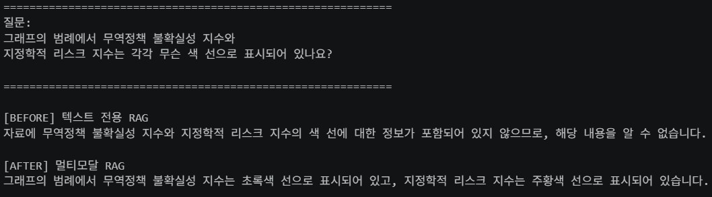

# 멀티모달 RAG 제출 전 점검

점검일: 2026년 11월 4일\
제출 기한: 2026년 11월 5일 목요일 오후 5시 이전(KST)\
대상: `main` 브랜치, 병합 커밋 `b96a7f0` 기준\
저장소: https://github.com/wjsworud1025/multimodal-rag

핵심 파이프라인은 구현됐지만 문서, 비교 실험, 검증 증거가 부족하다. 가장 먼저 현재 PDF가 수업에서 사용한 PDF와 다른 자료인지 확인해야 한다. 본 문서는 파일과 저장된 실행 결과에 대한 점검이며, 전체 노트북과 외부 API 호출을 다시 실행한 결과는 아니다.

## 1. 제출 기준별 현황

| 제출 항목 | 확인 결과 | 판정 |
| --- | --- | --- |
| 공개 GitHub 저장소 | 공개 상태 확인 | 충족 |
| README | 목업, 실행 기능 없음, PDF 자리표시자 등 현재와 다른 설명 | 수정 필수 |
| 아키텍처 다이어그램 | 없음 | 미충족 |
| 실행 노트북 | 최종 답변 포함 출력 존재, 코드 구문 검사 통과 | 부분 충족 |
| Before/After 비교 | 텍스트 RAG 비교 구현 및 캡처 없음 | 미충족 |
| 질의응답 5건 | 최종 질의는 `2026년 경제 전망` 1건 | 미충족 |

제출용 실행 노트북은 [Multi_modal_RAG.ipynb](notebooks/Multi_modal_RAG.ipynb)로 명시한다. 이 노트북에는 코드 셀 15개 중 6개에 출력이 있고 최종 답변도 남아 있다. 함수 정의 셀에 출력이 없는 것 자체는 문제가 아니다. 출력 없는 연습 노트북과 제출용 노트북을 구분해야 한다.

## 2. PDF 선정과 재현 가능성

현재 `data/invest.pdf`는 한국은행 「경제전망 Indigo Book, 2026년 2월」 내용을 담은 14페이지 PDF다. 표 내용과 이미지 추출 결과를 확인했다.

| 기준 | 현황 | 필요한 조치 |
| --- | --- | --- |
| 10~30페이지 | 14페이지 | 충족 |
| 그래프 또는 표 2개 이상 | 표 내용과 다수의 추출 이미지 확인 | 대표 그래프·표 2개 이상을 원문에서 직접 확인하고 페이지 기록 |
| 공개 자료 | 한국은행 경제전망 자료이나 저장소에 출처 링크 없음 | 공식 다운로드 링크와 발행일 기록 |
| 본인이 선정한 PDF | 수업 자료와 동일한지 저장소만으로 확인 불가 | 수업 PDF와 다른 자료인지 우선 확인 |
| 다른 사람의 재실행 | 샘플 `data/invest.pdf`를 저장소에 포함 | 저장소를 복제하면 동일한 입력 PDF 사용 가능 |

수업 PDF를 그대로 사용했다면 과제 무효 조건에 해당한다. 원문 일부를 발췌한 PDF라면 원본 페이지 범위도 명시한다. PDF를 Git에 반드시 넣어야 하는 것은 아니지만 같은 입력 파일을 준비할 수 있어야 한다.

## 3. 검색과 답변 품질의 문제

추출 → 요약 → 저장 → 검색 → 최종 답변 흐름은 연결되어 있다. 다만 답변이 어떤 원본에서 나왔는지 입증하는 정보가 부족하다.

| 위치 | 원인과 영향 | 필요한 보완 |
| --- | --- | --- |
| 추출 및 등록 | 요소를 문자열로 바꾸고 메타데이터에는 `doc_id`만 저장한다. 페이지와 원본 종류 추적이 어렵다. | 페이지, `text/table/image`, 이미지 파일명 보존 |
| 요약 출력 | 2026년 전망 요약에 `2023년 1/4분기`라는 표현이 있다. 연도 혼동이 의심된다. | 원문과 대조해 숫자·연도 검증 |
| 이미지 추출 | `data/figures/`에 이미지 138개가 있으며 파일명 기준 11페이지에서 93개 발생했다. | 잘게 나뉜 조각이나 불필요 이미지인지 확인 |
| 데이터 등록 | 실행할 때마다 새 UUID를 생성한다. | 등록 셀 반복 실행 시 중복 방지 |
| 이미지 전달 | PNG도 처리하지만 메시지 MIME은 항상 `image/jpeg`다. | 실제 파일 형식에 맞게 지정 |

현재 최종 답변에는 성장률과 물가 설명이 나오지만 검색한 원본 목록은 출력하지 않는다. 따라서 멀티모달 검색이 실제로 답변에 기여했는지 입증하기 어렵다. 질문마다 검색된 원본 종류와 페이지를 함께 기록해야 한다.

### Before/After 비교 원칙

같은 PDF, 질문, 답변 모델을 사용해 텍스트 RAG와 멀티모달 RAG를 비교한다. 텍스트 RAG에도 데이터를 정상 등록하고 가능한 한 검색 조건을 맞춘다. 이전의 빈 검색 결과와 현재 답변을 비교하면 이미지 활용 효과를 입증할 수 없다.

README에는 실제 실행 답변 캡처와 차이 설명을 함께 넣는다. 멀티모달 방식이 개선하지 못한 질문도 결과 그대로 기록한다.

### 질의응답 5건 기록 형식

| 질문 | 실제 답변 | 근거 원본 종류 | 원본 페이지 또는 이미지 | 검증 결과 |
| --- | --- | --- | --- | --- |
| 실행 후 작성 | 실행 후 작성 | 텍스트 / 표 / 이미지 | 확인 후 작성 | 원문 대조 후 작성 |

일반 요약뿐 아니라 표의 수치 비교, 그래프의 추세, 시나리오 차이 등을 묻는 질문을 포함한다. 위 표는 기록 형식이며 실제 평가 결과가 아니다.

## 4. 설치와 실행 안내

### requirements.lock.txt 형식 오류

[requirements.lock.txt](requirements.lock.txt)에는 패키지 목록 대신 다음 명령이 들어 있다.

```text
pip install -r requirements.txt
pip install unstructured-inference
```

README가 안내하는 `pip install -r requirements.lock.txt`는 올바른 설치 방법이 아니다. 실제 검증된 버전을 고정한 파일로 교체하거나 해당 설치 안내를 제거해야 한다.

### 추가 보완

1. `.env.example`에 값이 비어 있는 `OPENAI_API_KEY=` 항목을 추가한다.
2. README에 Poppler·Tesseract 설치, 커널 선택, 노트북 실행 순서를 설명한다.
3. PDF 경로 계산이 작업 디렉터리 `notebooks/`에 의존하므로 실행 위치를 명시하거나 경로 처리를 보완한다.
4. `src/extract.py`, `src/retriever.py`, `src/summarize.py`는 설명 문자열만 있으므로 실제 구현이 노트북에 있다는 점을 명확히 한다.
5. 토큰 기반 청크 설정을 `2000자`로 설명한 주석을 바로잡고 모델·청크 크기·한국어 프롬프트 선택 이유를 기록한다.

## 5. README와 아키텍처

[README.md](README.md)는 초기 목업 설명이라 현재 구현과 일치하지 않는다. 다음 다섯 묶음으로 정리한다.

1. **문제 정의와 자료:** 경제전망 문서의 표·그래프를 텍스트만으로 검색할 때의 문제, 선정 자료와 출처.
2. **아키텍처와 구조 이해:** 추출·요약 → 요약 색인 및 원본 저장 → 검색 및 원본 기반 답변의 3단계 다이어그램. 요약을 검색하고 원본으로 답하는 이유를 본인 말로 설명.
3. **실행 방법:** 환경, 의존성, OS 도구, PDF 배치, 환경변수, 커널 및 실행 순서.
4. **실험 결과:** 동일 질문의 Before/After 캡처와 차이 설명, 질의응답 5건 및 근거.
5. **기술 선택과 한계:** 모델·청크·프롬프트 언어 선택 이유, 추출·요약 오류, 비용, 메모리 저장소, 중복 등록 등.

Mermaid 다이어그램은 교안을 복사하지 않고 현재 코드의 저장소와 데이터 흐름에 맞춰 직접 작성한다.

## 6. 보안 점검

현재 확인 범위에서는 양호하다.

| 항목 | 결과 |
| --- | --- |
| 저장소 공개 여부 | PUBLIC |
| `.env` 추적 여부 | 현재 및 검사한 이력에서 추적 경로 없음 |
| `.gitignore` | `.env`, `.venv/`, 추출 이미지, 샘플 `data/invest.pdf` 이외의 PDF, 캐시 등 제외 |
| Git 이력의 주요 키 패턴 검사 | 파일 내용 31개 검사, OpenAI·GitHub·AWS 주요 패턴 발견 없음 |
| `.env.example` | 실제 키 없음. 환경변수 이름도 없어 템플릿 보완 필요 |

패턴 검사 결과가 모든 형태의 비밀정보 부재를 보증하지는 않는다. 제출 직전 노트북 출력, 추가 캡처, 새로 추적한 파일도 확인한다.

## 7. 마무리 작업 순서와 예상 시간

| 순서 | 작업 | 예상 작업 시간 |
| --- | --- | --- |
| 1 | 수업 PDF와 다른지 확인하고 공식 출처·사용 범위 기록 | 10~15분 |
| 2 | 설치 안내·환경변수 템플릿·경로 처리 정리 | 30~45분 |
| 3 | 원본 종류·페이지 추적 및 대표 추출물 점검 | 45~90분 |
| 4 | 질의 5건 실행, 텍스트 RAG와 비교, 실제 결과 캡처 | 60~120분 |
| 5 | README와 3단계 Mermaid 다이어그램 완성 | 45~60분 |

총 약 3~5시간 30분 예상. 전체 PDF 재추출 및 모델 호출 대기 시간은 별도다.

### 완료 체크리스트

- [ ] 수업 PDF와 다른 자료이며 출처·분량·대표 그래프 및 표를 확인했다.
- [ ] 새 환경에서 실행할 수 있도록 설치 안내와 입력 파일 준비 방법을 정리했다.
- [ ] 질의응답 5건을 실행하고 답변을 원문과 대조했으며 근거 종류·페이지를 기록했다.
- [ ] README에 직접 작성한 다이어그램과 실제 Before/After 캡처·차이 설명을 넣었다.
- [ ] 출력이 남은 제출용 노트북과 보안 상태를 확인하고 기한 전에 공개 저장소 링크를 제출했다.

**다음 행동: 현재 한국은행 PDF가 수업에서 사용한 PDF와 다른 자료인지 확인한다.**


# Multimodal RAG

PDF의 텍스트와 이미지를 활용하는 멀티모달 RAG 실습 프로젝트입니다.

## 텍스트 전용 RAG와 멀티모달 RAG 비교

같은 질문으로 그래프 범례의 색상을 비교했습니다. 텍스트 전용 RAG는 색상 정보를 찾지 못했고, 멀티모달 RAG는 무역정책 불확실성 지수를 초록색, 지정학적 리스크 지수를 주황색으로 답했습니다.



이 결과는 한 질문에 대한 실행 사례입니다. 두 검색기는 색인 대상이 서로 달라 답변 차이를 이미지 사용의 효과만으로 단정할 수 없습니다.

현재는 폴더와 파일 구조만 만든 목업입니다. 실행 기능이나 의존성은 아직 없습니다.

- `data/invest.pdf`: 저장소에 포함된 실습용 샘플 PDF입니다.
- `data/figures/`: 추출 이미지 저장 위치입니다.
- `notebooks/Multi_modal_RAG.ipynb`: 실습 노트북입니다.
- `src/`: PDF 파싱, 요약 체인, 다중 벡터 검색기 구현 위치입니다.

`.venv/`는 빈 폴더입니다. 실제 가상환경이 필요하면 `python -m venv .venv`로 생성하세요.
`.env`에 실제 키를 보관하며, `.env.example`에는 키 없는 설정 템플릿만 작성하세요.
`.env`, `.venv/`, `data/figures/`는 Git에서 제외됩니다.

git clone <저장소 주소>
cd multimodal-rag

# 가상환경 생성 및 활성화
python -m venv .venv
source .venv/bin/activate          # 윈도우: .venv\Scripts\activate

# 의존성 설치
pip install --upgrade pip
pip install -r requirements.txt     # 또는 requirements.lock.txt

# 커널 등록
python -m ipykernel install --user --name multimodal-rag

# .env 작성
cp .env.example .env                # 윈도우: copy .env.example .env
# .env 파일을 열어 실제 API 키를 입력
